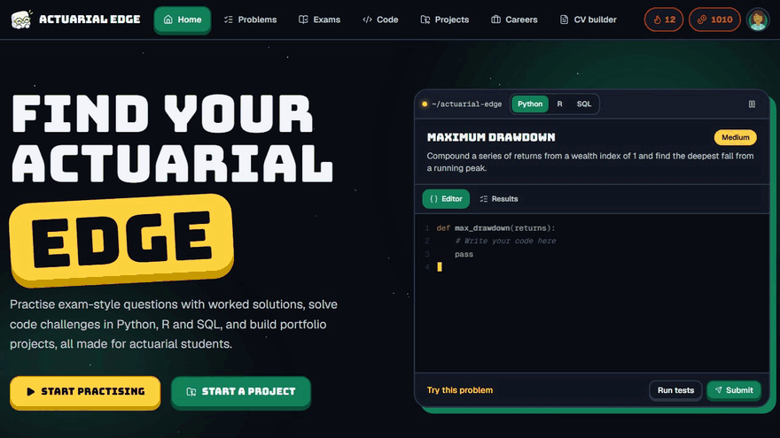
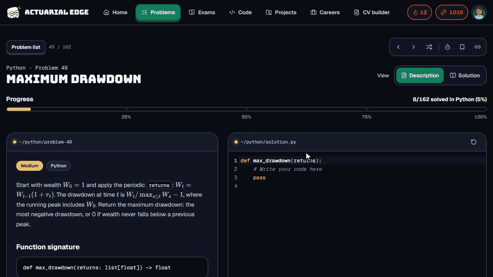
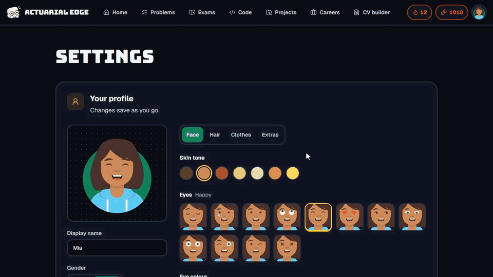

<div align="center">
  <a href="https://www.theactuarialedge.com">
    
  </a>

  <h1>The Actuarial Edge</h1>

  <p><b>Find your actuarial edge.</b><br/>
  Free, LeetCode-style practice for actuarial students: exam questions, coding problems, portfolio projects and career tools.</p>

  <p>
    <a href="https://www.theactuarialedge.com"><b>Start practising</b></a> ·
    <a href="#features">Features</a> ·
    <a href="#getting-started">Getting started</a> ·
    <a href="#contributing">Contributing</a> ·
    <a href="#support-the-project">Support</a>
  </p>

  <p>
    
    
    
  </p>

  <p>
    
    
    
    
    
    
    
  </p>
</div>

---

## 🎓 What it is

Actuarial exams reward practice, and practice is hard to come by. The Actuarial Edge is a place to
**do** the work: answer exam-style questions with worked solutions, write real code against test
cases, sit timed mock exams, and build the projects and CV that get you hired.

```text
CM1 · Problem 6       Calculate the accumulated value of 1 invested for 5 years at 4%.
Your answer           1.2167
                      ✓ Correct · +10 Actuary Bucks · 13-day streak 🔥
```

Everything runs in your browser. There's nothing to install and no account to make.

**[→ Start at theactuarialedge.com](https://www.theactuarialedge.com)**

<a id="features"></a>

## ✨ Features

### Practise for your exams

|                            |                                                                                          |
| -------------------------- | ---------------------------------------------------------------------------------------- |
| 📚 **1,236 questions**     | Mapped to IFoA and ASSA subjects (CS1, CS2, CM1, CM2, CB1, CB2) plus interview tracks    |
| 💡 **Worked solutions**    | Every question explains the method, with maths rendered properly                         |
| 🗺️ **Exam path**          | Work through each subject at your own pace and pick your difficulty level                |
| ⏱️ **Mock exams**          | 20 timed questions, a question navigator and flags, then a score by topic                |
| 🔁 **Spaced review**       | Questions you miss come back after 1, 3, 7 and 21 days until they stick                  |
| 📈 **Progress tracking**   | Streaks, accuracy, a year heatmap and progress in every subject                          |
| 📄 **Past papers**         | Links to the official IFoA and ASSA papers and examiners' reports                        |

### Learn to code like an actuary

<div align="center">
  
</div>

|                           |                                                                                     |
| ------------------------- | ----------------------------------------------------------------------------------- |
| 🐍 **162 Python problems** | Finance and pricing functions, 80 maths puzzles and 32 pandas problems               |
| 📊 **50 R problems**       | The same actuarial toolkit in R                                                      |
| 🗃️ **115 SQL problems**    | Policy, claims and customer data, from joins to window functions and streaks         |
| ⚡ **Instant feedback**    | Run your code against test cases right in the page and see exactly what passed        |
| 🧩 **Topic filters**       | Jump straight to finance, maths, pandas, joins, retention or medians                 |

### Get hired

|                              |                                                                                  |
| ---------------------------- | -------------------------------------------------------------------------------- |
| 🛠️ **Portfolio projects**    | Industry-style projects with full source code, the theory and CV bullet points    |
| 📝 **CV builder**            | Fill in a form and download a clean, ATS-readable PDF                             |
| 🧭 **Career guides**         | Qualifying as an actuary, careers in South Africa, certifications and more        |

### Play for it

<div align="center">
  
</div>

|                         |                                                                                   |
| ----------------------- | --------------------------------------------------------------------------------- |
| 🪙 **Actuary Bucks**    | Earn 10, 20 or 40 for every easy, medium or hard problem you solve                 |
| 🧑‍🎨 **Avatar builder**   | Design your own avatar: hair, face, eye colour, glasses and background are free   |
| 🛍️ **Avatar shop**      | Spend your bucks on outfits, prints, eyewear and hats, from Common to Legendary   |
| 🔥 **Streaks**          | Keep your daily streak alive and watch your heatmap fill up                       |

## 🛠️ Tech stack

**React 19** · **TypeScript** · **Vite** · **Tailwind CSS 4** · **React Router** · **CodeMirror 6** ·
**KaTeX** · **react-pdf**. Code runs entirely in the browser: Python (with pandas) on
**Pyodide**, R on **webR** and SQL on **sql.js**, each in its own worker with a time limit. Avatars use
the Avataaars art by Pablo Stanley through **DiceBear**. There is no backend: content is plain JSON
and Markdown compiled at build time, progress lives in `localStorage`, and the site is deployed to
GitHub Pages by GitHub Actions after the content checks, unit tests and browser tests pass.

<a id="getting-started"></a>

## 🚦 Getting started

```bash
git clone https://github.com/ArmandtErasmus/theactuarialedge
cd theactuarialedge
npm install
npm run dev
```

Then open <http://localhost:5173>. Node 22 or newer (24 recommended); Python 3 is only needed for the
content checks.

| Command                                   | What it does                                                    |
| ----------------------------------------- | --------------------------------------------------------------- |
| `npm run dev`                             | Dev server with hot reload                                      |
| `npm run build`                           | Type-check and build the site into `dist/`                      |
| `npm run check`                           | Content checks, every reference solution, and the unit tests    |
| `npm test`                                | The unit tests on their own                                     |
| `node scripts/e2e.ts http://localhost:5173` | Browser tests: every page, the main flows and all code problems |

## 📚 Documentation

- [Development guide](./docs/DEVELOPMENT.md): running, testing, adding content and the project layout
- [Writing code problems](./scripts/problems/README.md): how the Python and SQL problems are written and checked
- [Deploying](./SETUP.md): GitHub Pages and the custom domain

<a id="contributing"></a>

## 🤝 Contributing

Pull requests are welcome, especially new questions, worked solutions and coding problems.

1. Fork the repository
2. Create a branch: `git checkout -b feature/new-questions`
3. Make your changes, then run `npm run check` and `npm run build`
4. Commit and push, then open a pull request

Every pull request runs the content checks, unit tests, build and browser tests, and they need to
stay green. Spotted a wrong answer? [Open an issue](https://github.com/ArmandtErasmus/theactuarialedge/issues/new)
with the question number.

<a id="support-the-project"></a>

## ⭐ Support the project

The Actuarial Edge is free, has no ads and needs no account. Support pays for the domain and the
time that goes into new questions and problems.

<p align="center">
  <a href="https://github.com/ArmandtErasmus/theactuarialedge">
    
  </a>
  <a href="https://buymeacoffee.com/theactuarialedge">
    
  </a>
</p>

Not in a position to give? A star helps just as much, and sharing it with someone studying for their
next exam helps even more.

## 📜 License

MIT, see [LICENSE](./LICENSE). The Actuarial Edge is not affiliated with the IFoA or ASSA.

---

<p align="center">
  Built by <a href="https://github.com/ArmandtErasmus">Armandt Erasmus</a>
</p>
